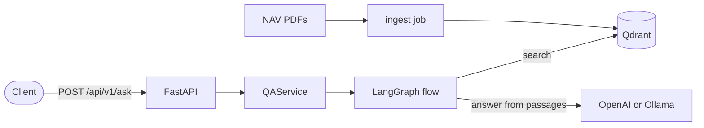
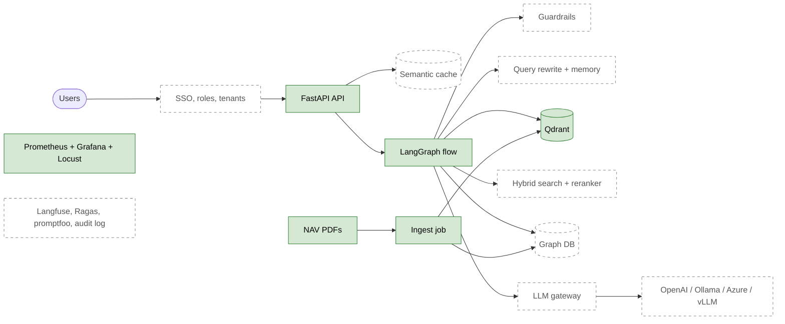

# Hungarian Tax Information Assistant

A Python backend with a RAG component that answers questions about Hungarian corporate
tax from the official NAV information booklets, and shows the booklet and page each
answer comes from. If the booklets don't cover a question, it says so instead of guessing.

## The problem

In a mid-sized Hungarian company, finance, controlling and management keep asking the
tax team the same questions: when is the corporate tax return due, what reduces the tax
base, which allowances can we claim. The answers are in NAV's information booklets, but
those are long PDFs. This app lets any employee ask in plain Hungarian or English and get
a short, sourced answer.

**Data:** four NAV information booklets, 2026 edition: corporate tax rules, growth tax
credit, TAO donations, nonprofit taxation. Public and non-confidential. They are not in
this repository (they belong to NAV); step 2 below downloads them.

**Out of scope:** tax advice, tax calculations, company data.

---

## Quick start

You need Docker Desktop (or Docker Engine with Compose). Run the commands from the
project folder. Where Windows and macOS/Linux differ, both versions are given.

### 1. Create the settings file

Windows (PowerShell):

```powershell
Copy-Item .env.example .env
```

macOS / Linux:

```bash
cp .env.example .env
```

Open `.env` and set:
- `LLM_PROVIDER=openai` and your `OPENAI_API_KEY`, or `LLM_PROVIDER=ollama` for the free local mode.
- `API_KEY=` any secret text. Clients must send it in the `X-API-Key` header.

### 2. Download the booklets

Windows (PowerShell), paste the whole block:

```powershell
$base = "https://nav.gov.hu/pfile/file?path=%2Fugyfeliranytu%2Fnezzen-utana%2Finf_fuz%2F2026%2F"
New-Item -ItemType Directory -Force data/raw | Out-Null
curl.exe -fL -o "data/raw/13 A nonprofit szervezetek adózása 20261001.pdf" "${base}13.-a-nonprofit-szervezetek-adozasa-2026-10-01"
curl.exe -fL -o "data/raw/41 A társasági adó legfontosabb szabályai 20260202.pdf" "${base}41.-A-tarsasagi-ado-legfontosabb-szabalyai-2026.02.02"
curl.exe -fL -o "data/raw/55 Tao-felajánlás 20260728.pdf" "${base}55.-Tao-felajanlas-2026.-07.-28."
curl.exe -fL -o "data/raw/93 Növekedési adóhitel 20260130.pdf" "${base}93.-Novekedesi-adohitel-20260130"
```

macOS / Linux, paste the whole block:

```bash
base="https://nav.gov.hu/pfile/file?path=%2Fugyfeliranytu%2Fnezzen-utana%2Finf_fuz%2F2026%2F"
mkdir -p data/raw
curl -fL -o "data/raw/13 A nonprofit szervezetek adózása 20261001.pdf" "${base}13.-a-nonprofit-szervezetek-adozasa-2026-10-01"
curl -fL -o "data/raw/41 A társasági adó legfontosabb szabályai 20260202.pdf" "${base}41.-A-tarsasagi-ado-legfontosabb-szabalyai-2026.02.02"
curl -fL -o "data/raw/55 Tao-felajánlás 20260728.pdf" "${base}55.-Tao-felajanlas-2026.-07.-28."
curl -fL -o "data/raw/93 Növekedési adóhitel 20260130.pdf" "${base}93.-Novekedesi-adohitel-20260130"
```

Keep the file names: the booklet number, title and date are read from them. If this
step is skipped, the start command fails with a message pointing back here.

### 3. Start

Choose one. Each command returns when the app is ready. The first start takes longer:
the booklets are indexed, and in local mode the models are downloaded.

With OpenAI (`LLM_PROVIDER=openai`):

```bash
docker compose up --build -d --wait
```

Free local mode with an NVIDIA GPU (`LLM_PROVIDER=ollama`):

```bash
docker compose --profile local up --build -d --wait
```

Free local mode without an NVIDIA GPU, on the CPU (`LLM_PROVIDER=ollama`, uses the
smaller `gemma3:4b`):

```bash
docker compose -f docker-compose.yaml -f docker-compose.cpu.yaml --profile local up --build -d --wait
```

On a Mac, local mode is faster with Ollama installed natively (it uses the Apple GPU).
Install it from ollama.com, then:

```bash
ollama pull gemma3:12b
ollama pull bge-m3
```

Set `OLLAMA_BASE_URL=http://host.docker.internal:11434` in `.env`, then start without
the local profile:

```bash
docker compose up --build -d --wait
```

### 4. Ask a question

Open http://localhost:8000/docs, click Authorize, enter your `API_KEY`, then try
`POST /api/v1/ask`. Or from the command line (replace `my-secret` with your `API_KEY`):

Windows (PowerShell):

```powershell
Invoke-RestMethod -Method Post -Uri http://localhost:8000/api/v1/ask -ContentType "application/json; charset=utf-8" -Headers @{ "X-API-Key" = "my-secret" } -Body '{"question": "Mikor kell benyújtani a társasági adó bevallását?"}'
```

macOS / Linux:

```bash
curl -X POST http://localhost:8000/api/v1/ask -H "Content-Type: application/json" -H "X-API-Key: my-secret" -d '{"question": "Mikor kell benyújtani a társasági adó bevallását?"}'
```

More sample requests are in `app/main.http`.

### 5. Run the tests

```bash
docker compose run --rm --build tests
```

Integration tests against the running app:

```bash
docker compose run --rm tests python -m pytest -m integration -v
```

### 6. Stop

```bash
docker compose --profile "*" down
```

The indexed booklets and downloaded models are kept in Docker volumes; add `-v` to
delete them.

---

## How it works



1. **Ingestion** (separate container, runs once before the API starts): reads the PDFs,
   removes page numbers, tables of contents and footnotes, joins broken lines, splits the
   text into ~1000-character chunks with 200 overlap, embeds them and stores them in
   Qdrant. Each chunk keeps its booklet title and page.
2. **A question** goes through a LangGraph graph:
   - detect the language (Hungarian or English)
   - retrieve the 4 most similar chunks and drop those below a similarity threshold
   - if none are left: a fixed "not covered" answer, without calling the LLM
   - otherwise: the LLM answers only from those chunks, citing title and page

**Code layout (`app/`):**
- `api/`: routes, request/response schemas, API-key check
- `services/`: application logic (timeout, error mapping, response)
- `rag/`: the graph, language detection, ingestion
- `integrations/`: OpenAI, Ollama, Qdrant
- `core/`: settings, error types, metrics

Provider-specific code exists only in `integrations/`, so the graph can be tested with
fakes and the provider is switched by configuration.

**Key decisions:**
- **A separate ingestion job:** it never runs in parallel across replicas, and the API
  starts fast.
- **A similarity threshold per embedding model** (OpenAI 0.32, Ollama 0.45): a vector
  search always returns results, so the threshold decides "nothing relevant". The two
  models score differently.
- **One Qdrant collection per provider:** their vectors have different sizes and must
  not mix.
- **Qdrant as the vector store:** a real vector database in one container with persistent
  storage, shared by any number of API instances, with metadata filtering and hybrid
  search available for later. An in-memory index would be lost on restart and could not
  be shared.
- **~1000-character chunks with 200 overlap:** big enough to keep a rule together with its
  conditions, small enough for precise matches; the overlap keeps sentences that cross a
  chunk boundary findable.
- **One error format** with a request ID. Every log line carries the same request ID;
  questions are logged by length only, not their text.

**Trade-offs:**
- **LangChain interfaces for models and the vector store:** an extra dependency layer, in
  exchange for switching providers by configuration and testing with fakes.
- **A fixed similarity threshold:** simple and free, but some valid English questions fall
  below it.
- **Rule-based language detection:** instant and dependency-free, but fooled by English
  questions containing accented Hungarian terms.
- **No answer without retrieval hits:** off-topic questions cost no model call, but a
  question phrased very differently from the booklets may be refused.
- **A separate ingestion container:** one more service to run, in exchange for a fast,
  stateless API.

---

## Models

| | OpenAI (primary) | Ollama (free, local) |
|---|---|---|
| Chat | `gpt-4.1-mini`: good Hungarian, cheap, fast | `gemma3:12b` (GPU) or `gemma3:4b` (CPU): multilingual, freely available |
| Embeddings | `text-embedding-3-small` | `bge-m3` (multilingual) |
| Needs | an API key | see the hardware table below; internet for the first download |

Local mode hardware:

| Setup | Chat model | Memory | Disk | Speed (one question) |
|---|---|---|---|---|
| NVIDIA GPU | `gemma3:12b` | ~10 GB GPU memory | ~10 GB | a few seconds |
| CPU only | `gemma3:4b` | ~6 GB RAM for Docker | ~5 GB | about 10–30 s |
| Mac, native Ollama | `gemma3:12b` | 16 GB unified memory recommended | ~10 GB | a few seconds |

How local mode works:
- The `ollama` container runs the model server. In GPU mode it reserves the NVIDIA GPU;
  `docker-compose.cpu.yaml` removes that reservation, switches to the smaller chat model
  and raises the timeout to 300 s.
- The `ollama-init` container downloads the models once (kept in a Docker volume) and
  loads the chat model into memory before the app reports ready.
- The app reaches Ollama at `OLLAMA_BASE_URL`: `http://ollama:11434` inside Compose, or
  `http://host.docker.internal:11434` for an Ollama installed on the host.
- The embedding model is `bge-m3` in every local setup, so the similarity threshold does
  not change.
- No paid key is needed at all, embeddings included.
- Limitations: slower than OpenAI, especially on the CPU and under load. The smaller CPU
  model gives shorter, less precise answers. With Compose, the chat model is loaded during startup and
  kept in memory for an hour; after that, or with a natively installed Ollama, the next
  question waits while the model loads.

To switch provider, change `LLM_PROVIDER` in `.env` and run the start command again.
All settings, with their defaults, are listed in `.env.example`.

---

## API

`POST /api/v1/ask` with the header `X-API-Key`:

```json
{"question": "Mi a növekedési adóhitel?", "top_k": 4}
```

The response contains `answer`, `answered` (false if the booklets don't cover it),
`sources` (booklet title, page, passage, similarity score), `model` and `timestamp`.

`GET /health` shows the Qdrant status, the number of indexed chunks and the provider.
It needs no key.

Every error has the same shape:
`{"error": "...", "message": "...", "request_id": "...", "timestamp": "..."}`

| Status | Meaning |
|---|---|
| 401 | missing or wrong API key |
| 422 | invalid question (empty, under 3 or over 1000 characters, invalid JSON) |
| 502 | the model provider failed |
| 503 | Qdrant unavailable, or provider rate limit (with `Retry-After`) |
| 504 | no answer within 60 s |

---

## Tests

- **Unit tests** (101) use a fake model and a fake vector store, so they need no network
  or API key. They cover:
  - a successful answer
  - invalid input
  - no relevant passage
  - model errors and a real timeout
  - authentication
  - every ingestion cleaning step
  - metrics
  - a test sending 20 parallel requests, where each must get only its own answer
- **Integration tests** run against the real stack: Hungarian and English questions,
  an off-topic question, invalid input, and a missing key.
- **blockbuster** runs in every test and fails it if a blocking call runs on the async
  event loop.

---

## Concurrency and scaling

**Request isolation:**
- There is no shared mutable state: settings are immutable, and the clients and the
  graph are only read after startup.
- Each request has its own graph state.
- The parallel-request test proves no answers mix.

**Blocking work:**
- The request path is async.
- Synchronous library calls run in threads.
- Ingestion is a separate job.
- blockbuster confirms nothing blocks the event loop.

**Resource limits:**
- A semaphore limits parallel LLM calls per process (`MAX_CONCURRENT_LLM_CALLS`).
- A 60 s timeout covers each question.
- OpenAI calls retry 3 times.
- Rate limits return 503 with `Retry-After`.
- Next step: return 503 immediately when overloaded, instead of queueing until the
  timeout.

**Multiple instances:**
- The API is stateless and can run as several replicas.
- Qdrant is the shared store.
- The parallel-call limit is per instance, so with OpenAI a shared limiter (e.g. Redis)
  would be needed.

**Bottleneck, measured:**
- With the optional monitoring and load test:
  ```powershell
  docker compose --profile local --profile monitoring --profile loadtest up -d --wait
  ```
  - Grafana: http://localhost:3000
  - Locust: http://localhost:8089
- Result with 4 users on one GPU: no failures, but a median of 21 s and about 11
  answers per minute. The model itself slowed to ~28 s at p95.
- **The limit is model inference, not the API.**
- Improvement order:
  1. Cache repeated questions.
  2. Fail fast under overload.
  3. More model capacity: an LLM gateway with routing and fallback, or vLLM.
  4. Then more API replicas.

---

## Where this MVP is heading

This repository is the core of a larger system. Green is built, dashed is planned:



| Phase | Items |
|---|---|
| 1. Quality | Ragas evaluation set; hybrid search (keywords + vectors, for terms like "Tao. tv. 22/E. §"); a reranker; tax-year filter (rules change yearly); query rewrite for English questions |
| 2. Scale and cost | semantic cache; LLM gateway with routing (small model for simple questions) and fallback; fail-fast overload handling |
| 3. Enterprise | SSO and per-client tenants; guardrails (PII masking, prompt injection); audit log; Langfuse tracing; promptfoo prompt tests in CI |
| 4. Advanced | a graph database for legal cross-references; a document upload pipeline with OCR and versioning; conversation memory |

---

## Known limitations

- Only lookup questions about the four 2026 booklets.
- English questions match the Hungarian text less well; some fall below the threshold.
- Language detection is rule-based: an English question with an accented Hungarian
  term is treated as Hungarian.
- `sources` are the passages the model received, not proof of which sentences it used.
- Re-indexing is skipped when the chunk count matches, so a changed PDF with the same
  number of chunks is not re-indexed.
- No conversation history: each question stands alone.

The NAV information booklets are © Nemzeti Adó- és Vámhivatal and are not redistributed
here.
