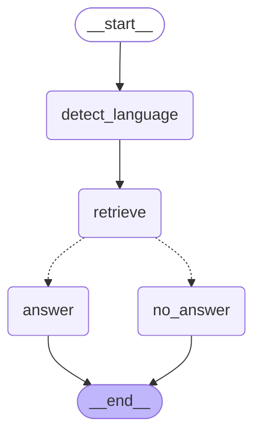

# Hungarian Tax Information Assistant


Imagine a mid-sized Hungarian company. Tax questions come up in many departments every week:
- Finance needs to know when the corporate tax return is due.
- Controlling asks which items reduce the tax base.
- Management asks which tax allowances the company can claim.

The answers are in the official information booklets of the Hungarian tax authority (NAV), but these are long PDF documents. So people either search through them by hand, or send the question to the tax team, which answers the same questions again and again.

This app lets any employee ask such a question in plain language and get a short answer, with a reference to the exact booklet and section it came from.

## What the app does

The app answers questions about Hungarian corporate income tax (*társasági adó*) using RAG (Retrieval-Augmented Generation):
1. It searches the booklets for the passages most relevant to the question.
2. A language model writes a short answer using only those passages.
3. The answer is returned together with its sources, so the user can check it.

If the booklets do not cover the question, the app says so instead of guessing. Questions can be asked in Hungarian or English.

## Example questions

- *"Mikor kell benyújtani a társasági adó bevallását?"* ("When is the corporate tax return due?")
- *"Milyen tételek csökkentik a társasági adó alapját?"* ("Which items reduce the corporate tax base?")
- *"Ki a társasági adó alanya?"* ("Who is subject to corporate income tax?")
- *"Mi a legjobb pizza feltét?"* ("What is the best pizza topping?"): not covered, so the app says it cannot help.

## Quick start

Requirements: Docker with Docker Compose. For local mode you also need an NVIDIA GPU (about 10 GB of VRAM for the default models).

**1. Configure.** Copy the example config and choose a provider:

```powershell
Copy-Item .env.example .env
```

- `LLM_PROVIDER=openai`: cloud mode. Set `OPENAI_API_KEY` in `.env`.
- `LLM_PROVIDER=ollama`: local mode. Free, and no data leaves the machine.
- `API_KEY`: the key clients send in the `X-API-Key` header to use `/api/v1`. Generate one with `python -c "import secrets; print(secrets.token_urlsafe(32))"`. If it is empty, the API is open and the backend logs a warning. That is only acceptable for local development. `/health` never needs a key.

**2. Download the booklets.** The PDFs are not part of this repository. They belong to NAV and are downloaded from its [Információs füzetek 2026](https://nav.gov.hu/ugyfeliranytu/nezzen-utana/inf_fuz/2026) page. Run this from the project root:

```powershell
$base = "https://nav.gov.hu/pfile/file?path=%2Fugyfeliranytu%2Fnezzen-utana%2Finf_fuz%2F2026%2F"
New-Item -ItemType Directory -Force data/raw | Out-Null
curl.exe -fL -o "data/raw/13 A nonprofit szervezetek adózása 20261001.pdf" "${base}13.-a-nonprofit-szervezetek-adozasa-2026-10-01"
curl.exe -fL -o "data/raw/41 A társasági adó legfontosabb szabályai 20260202.pdf" "${base}41.-A-tarsasagi-ado-legfontosabb-szabalyai-2026.02.02"
curl.exe -fL -o "data/raw/55 Tao-felajánlás 20260728.pdf" "${base}55.-Tao-felajanlas-2026.-07.-28."
curl.exe -fL -o "data/raw/93 Növekedési adóhitel 20260130.pdf" "${base}93.-Novekedesi-adohitel-20260130"
```

On Linux or macOS, use the same lines with `base="..."`, `mkdir -p data/raw` and `curl` instead of `curl.exe`.

Keep the file names as they are: the booklet number, title and publication date are read from them. NAV replaces the files when it publishes a new edition, so if a link stops working, download the current edition from the page above and name it in the same format.

**3. Start.**

```powershell
# Cloud mode (OpenAI)
docker compose up --build -d --wait

# Local mode (Ollama on the GPU)
docker compose --profile local up --build -d --wait
```

On the first start the booklets are read, split into chunks and stored in Qdrant. In local mode the models are downloaded first (several GB). Later starts reuse both and skip this work. `--wait` makes the command return only when the backend reports `healthy`, which happens after indexing has finished. Indexing runs in the separate `ingest` container, which exits when it is done; the backend starts after it. To follow progress, run `docker compose logs -f ingest` in a second terminal.

**4. Try it.**

- Swagger UI: http://localhost:8000/docs
- Health check: http://localhost:8000/health
- Sample requests: [`app/main.http`](app/main.http), which runs in VS Code (REST Client) or JetBrains IDEs. Set `@apiKey` at the top of the file first.
- From PowerShell:

```powershell
Invoke-RestMethod -Method Post -Uri http://localhost:8000/api/v1/ask -ContentType "application/json; charset=utf-8" -Headers @{ "X-API-Key" = "<your API_KEY>" } -Body '{"question": "Mikor kell benyújtani a társasági adó bevallását?"}'
```

In local mode the first question takes up to a minute while the model loads into GPU memory. After that, answers take a few seconds.

**5. Run the tests.**

```powershell
# Unit tests: mocked, no Qdrant or LLM needed
docker compose run --rm --build tests

# Integration tests: against the running stack from step 3
docker compose run --rm --build tests python -m pytest -m integration -v
```

**Stop** with `docker compose --profile local down`. The indexed chunks and downloaded models are kept in Docker volumes. Add `-v` to delete them too.

## Data

- The 4 NAV information booklets on corporate income tax (*Információs füzetek*, 2026 edition): official, public, Hungarian-language PDFs.
- This is a deliberately small example set. Other tax types, such as VAT or payroll taxes, can be added by adding their booklets. The application itself does not change.

## Limitations

- It answers lookup questions: rules, deadlines, obligations and conditions written in the booklets. It does not calculate taxes or analyse company data.
- Its knowledge is limited to the selected 2026 booklets.
- It provides information, not tax advice.

## Architecture



## Blocking-call check

The app is async, so one blocking call on the event loop would stall every request in the same worker. To check for this, the tests run with [blockbuster](https://github.com/cbornet/blockbuster), the Python counterpart of Java's BlockHound. It raises an error when a blocking call, such as `time.sleep`, a sync socket or a file read, runs on the event loop.

- **How:** an autouse fixture in `tests/conftest.py` turns it on for every test. A deliberate `time.sleep` in an async test was caught, which confirms the check works.
- **Unit tests:** no blocking calls in the routes, the service, the error handlers or the graph nodes.
- **`tests/integration/test_blocking_integration.py`:** runs the real graph in-process (real embedding, Qdrant and LLM). No blocking calls on the event loop.
- **Note:** the HTTP integration tests don't check the backend, because blockbuster only sees the process it runs in.

**Finding:** the LLM calls (`ChatOllama` and `ChatOpenAI`) are truly async. Retrieval is not: `QdrantVectorStore` has no async search, so LangChain runs the sync embedding and Qdrant query in the default thread pool. This doesn't block the loop, but every request in retrieval holds one thread, and the pool's default size, `min(32, CPU count + 4)`, becomes a hidden concurrency limit under load.

**Next step:** a custom `retrieve` using `AsyncQdrantClient` and `aembed_query`, so that the whole request path is truly async.
